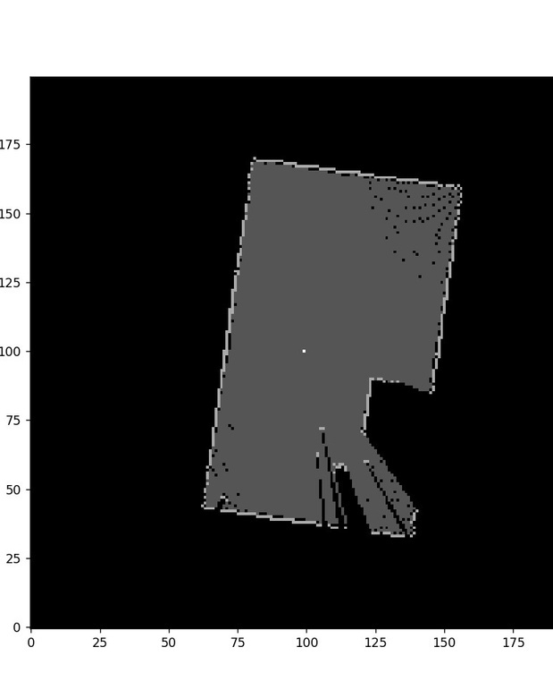
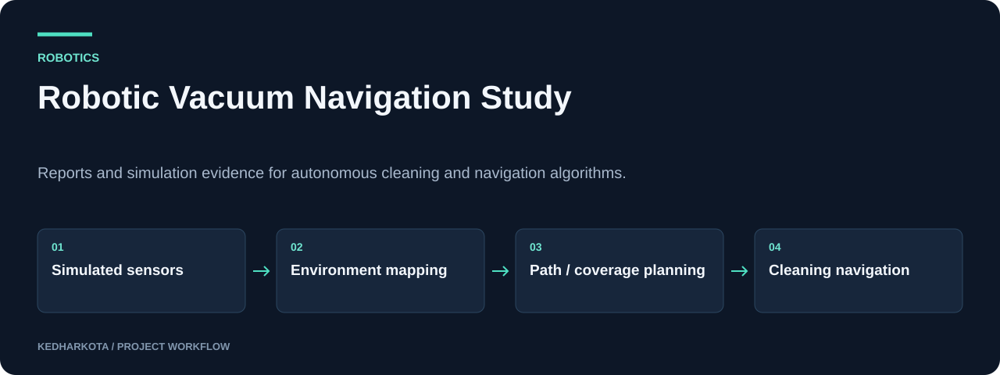

# Robotic Vacuum Navigation Study

Reports and simulation evidence for autonomous cleaning and navigation algorithms.

**Webots · SLAM · Path planning · Robotics simulation**

[Overview](#overview) · [Getting started](#getting-started) · [Repository guide](#repository-guide) · [Reproducibility](docs/REPRODUCIBILITY.md)



*Original map figure extracted from the final review, page 8.*

## Overview

A research and coursework archive examining navigation for a simulated robotic vacuum cleaner. The committed material consists of a final review, a report, and a research paper, covering mapping, obstacle avoidance, dirt detection, and coverage-oriented planning.

## What this project includes

- Webots-based autonomous cleaning methodology described in the review.
- Discussion of SLAM and virtual sensor integration.
- Planning comparisons including A*, Dijkstra, boustrophedon, zig-zag, spiral, and breadth-first search in the project material.
- Original simulation and map figures retained in the final review.

## Workflow



*Explanatory diagram. Detailed implementation and availability notes follow below.*

## Getting started

Begin with `Final_Review.pdf` for the project's objectives, methods, and simulation results. Use `Report.docx` and `Research_paper.pdf` for the accompanying written material.

This checkout contains documents only. To rerun the simulation, restore the corresponding Webots world, robot configuration, controller source, assets, and version information; those files are not committed here.

### Required inputs and current constraints

Reproduction requires the original Webots scene and controller implementations, plus scenario definitions and metric calculations. The separate `webots` repository on this account is an upstream simulator fork and does not by itself establish that this project's controller source is available.

## Repository guide

| File | Purpose |
| --- | --- |
| [Final_Review.pdf](Final_Review.pdf) | Project review, methodology, and simulation figures. |
| [Report.docx](Report.docx) | Written project report. |
| [Research_paper.pdf](Research_paper.pdf) | Research paper included with the project. |

## Results and project status

The map preview above is extracted from page 8 of the committed final review. Algorithm names reflect the project material, while executable implementations and raw comparison tables are absent from this checkout. The README therefore presents this as a study archive.

## Next steps

- Publish the project-specific worlds and controller source.
- Add repeatable coverage, path-length, collision, and runtime measurements for each scenario.

## Documentation maintenance

Local documentation links and image headers are checked on pull requests and relevant pushes by the [documentation workflow](.github/workflows/docs.yml). Run the same check locally:

```bash
python tools/check_docs.py
```

See the [reproducibility guide](docs/REPRODUCIBILITY.md) for evidence, missing artifacts, and visual-source notes. The check validates documentation files; it does not train models or certify application behavior.

---

[More projects by kedharkota](https://github.com/kedharkota?tab=repositories)
